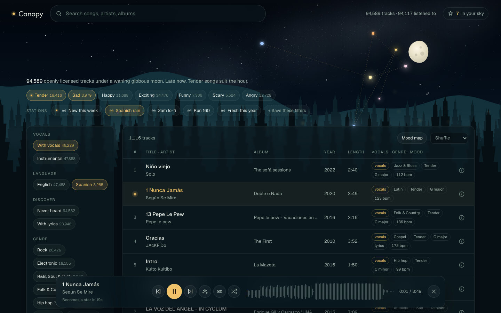
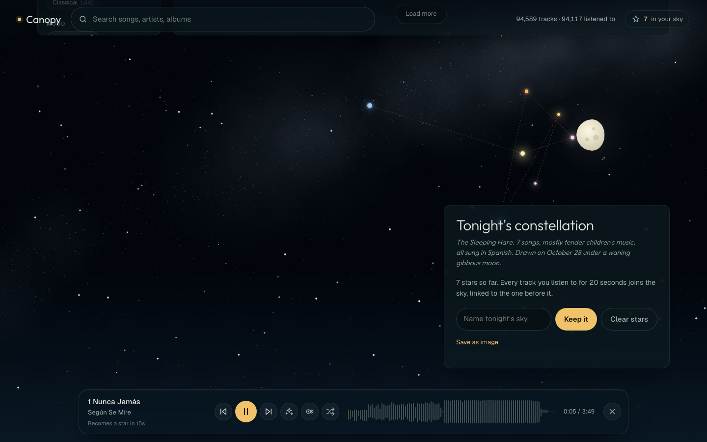
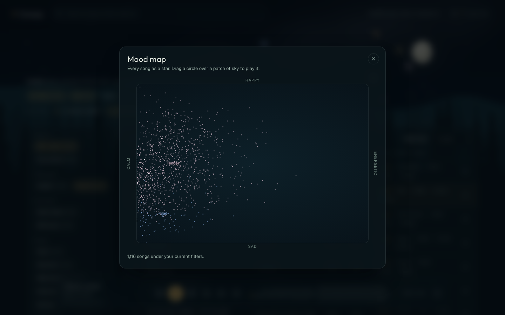
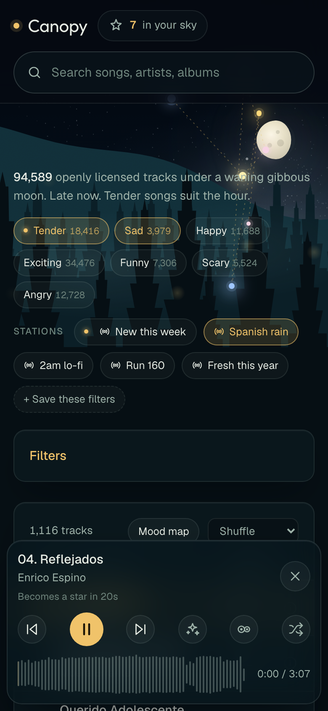

# Canopy

A personal music library of about 95,000 songs that anyone may legally stream, set in a night forest under a real sky. Every song you listen to for 20 seconds becomes a star, and each session leaves a constellation behind.

Canopy hosts no audio. It keeps an index and streams every song from the site the artist put it on. It is a personal learning project, not a product.



## What it does

- **Search and filter** 94,589 openly licensed songs by title, artist or album, vocals, language, genre, mood, tempo, key, year, source and licence. You can also show only songs you've never heard, or only songs with lyrics.
- **Play** them in a waveform player with shuffle, **more like this**, a **DJ mode** that crossfades songs matched by tempo, key and mood, and **stations** that play endlessly.
- **Explore the mood map:** every song is a dot placed from calm to energetic and from sad to happy. Drag a circle over a patch to play it.
- **Live under a real sky:** the moon shows tonight's phase, the sky follows the clock, shooting stars carry a song you haven't heard, and fireflies flash on the beat.
- **Keep your constellation:** stars are coloured by each song's mood and joined in the order you heard them. Each constellation gets a generated name and a one-line myth.
- **Read lyrics** for about 24,000 songs.
- **Grow on its own:** a weekly job collects new uploads, analyses them and offers them as a "New this week" station.

| Your sky | Mood map | Phone |
|---|---|---|
|  |  |  |

## The library

| Source | Tracks | Licence | Streams from |
|---|---|---|---|
| Jamendo (live API) | 54,856 | Creative Commons | Jamendo |
| Audius | 14,391 | Audius Open Music License (stream only) | Audius API |
| Free Music Archive (Internet Archive mirror) | 5,144 | usually unrecorded | archive.org |
| Netlabels (Internet Archive) | 5,105 | Creative Commons | archive.org |
| Jamendo (older Internet Archive mirror) | 5,061 | Creative Commons | archive.org |
| Internet Archive community CC uploads | 5,026 | uploader-asserted CC | archive.org |
| ccMixter | 5,006 | Creative Commons | relayed by the server (ccMixter refuses hotlinks) |

Counts are from 28 October 2026. Nothing recorded before 1925 is included. A census of the Internet Archive's openly licensed collections estimated about 1.29 million tracks after removing mislabelled uploads, and Canopy indexes a sample of them.

## How it is built

```
Internet Archive, ccMixter, Jamendo, Audius
        │  scripts/ingest_*.py          (standard library only)
        ▼
data/music.db  (SQLite + FTS5)  ◀── scripts/analyze.py   tempo, key, loudness; PANNs vocals, genre, mood
        │                       ◀── scripts/build_map.py  mood map positions
        │                       ◀── scripts/fetch_lyrics.py
        ▼
app/server.py  (FastAPI)  ──▶  app/static/index.html  (one file, no build step; WaveSurfer 7, canvas, SVG)
```

- **Analysis from a slice:** `analyze.py` range-requests about 0.5 MB from 35% into each MP3, and `mp3chunk.py` finds the first valid frame so the slice decodes. That is 0.5 MB per track instead of 5–10 MB.
- **Vocals, genre and mood** come from the PANNs Cnn14 AudioSet tagger. A track counts as vocal when its singing score is ≥ 0.10 or its speech score is ≥ 0.15, a rule calibrated by eye.
- **The forest and sky** are drawn entirely in code: nine layered planes (sky, Milky Way, constellation, moon, ridge, two rows of generated pines, mist, fireflies) that move at different speeds as you scroll.

[docs/CANOPY.md](docs/CANOPY.md) is the long version: every feature, the design, the data pipeline, the testing, the caveats and the roads not taken.

## Run it

The library itself (`data/music.db`, about 150 MB) is not in the repo. Build it first:

```bash
uv venv .venv --python 3.12
uv pip install --python .venv/bin/python -r requirements.txt
echo YOUR_JAMENDO_CLIENT_ID > .jamendo_client_id     # free from devportal.jamendo.com

python3 -I scripts/count_ia.py                         # census + Internet Archive item lists
python3 -I scripts/ingest.py --tracks-per-source 5000
python3 -I scripts/ingest_ccmixter.py --tracks 5000
python3 -I scripts/ingest_jamendo.py --lang en --tracks 50000
python3 -I scripts/ingest_jamendo.py --lang es --tracks 60000
python3 -I scripts/ingest_audius.py --tracks 10000
caffeinate -i .venv/bin/python -I scripts/analyze.py   # most of a day on a CPU; builds the mood map at the end
python3 -I scripts/fetch_lyrics.py

.venv/bin/uvicorn app.server:app --port 8765           # then open http://localhost:8765
```

Every step is resumable. Analysis also needs the PANNs checkpoint in `~/panns_data`; [docs/CANOPY.md §12](docs/CANOPY.md#12-rebuilding-canopy-from-scratch) has the download and checksum.

### Weekly refresh (macOS)

```bash
sed -e "s|__CANOPY__|$PWD|g" -e "s|__HOME__|$HOME|g" \
  scripts/canopy.refresh.plist > ~/Library/LaunchAgents/canopy.refresh.plist
launchctl load ~/Library/LaunchAgents/canopy.refresh.plist
```

It runs every Sunday at 04:00, or on the next wake. If the project lives under `~/Documents`, give Python Full Disk Access first (System Settings → Privacy & Security), or the job hangs at startup.

## Caveats

- Language is tagged only for Jamendo and some Internet Archive items.
- Community uploads carry licences asserted by the uploader. The obvious mislabelled dumps are filtered out, but others will remain.
- Audius tracks are stream-only: listen, don't reuse. Covers and DJ mixes are skipped, but unlabelled ones can slip through.
- Tempo can read half or double time, and genre and mood come from coarse AudioSet classes.

## Licence

The code is MIT, see `LICENSE`. The music belongs to its artists under the licences shown on each track.
